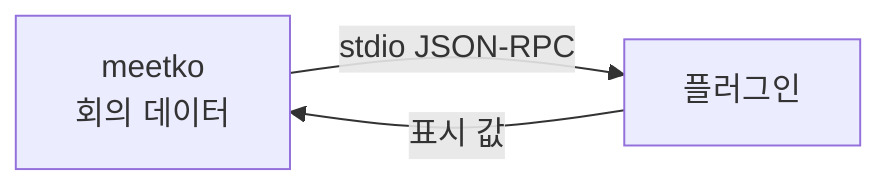

<div align="center">

# meetko-plugins

**[meetko](https://github.com/Eastsidegunn/meetko) 플러그인: 목록 저장소이자 공식 예제 모음.**

[](LICENSE)
[](#플러그인-목록)
[](https://github.com/Eastsidegunn/meetko)

[English](README.md) · **한국어**

</div>

---

한국어·영어 회의 전사본을 내 컴퓨터에서 만드는 로컬 우선 앱 meetko의 플러그인 목록 저장소입니다. 앱의 **둘러보기**는
이 저장소의 [`index.json`](index.json)을 읽고, 공식 예제 플러그인도 여기 폴더로 들어 있습니다.

## meetko 플러그인이란

플러그인은 함수처럼 동작하는 별도 프로그램입니다. meetko가 회의 데이터(단어마다 id·시각·화자가 붙은 전사본)를 stdio
JSON-RPC로 건네면, 플러그인은 요약 카드, 액션아이템, 표처럼 앱이 보여 줄 값을 돌려줍니다. 플러그인마다 `meetko.toml`
매니페스트가 있어서 무엇을 읽는지, 어떤 권한(네트워크, API 키, 설정)이 필요한지 선언하고, 사용자는 설치하기 전에 이를
보고 동의합니다.



매니페스트 형식: meetko의 [docs/manifest-draft.md](https://github.com/Eastsidegunn/meetko/blob/main/docs/manifest-draft.md).
meetko에서 플러그인 쓰기(영어): [docs/plugins.md](https://github.com/Eastsidegunn/meetko/blob/main/docs/plugins.md)

## 플러그인 목록

| 폴더 | id | 하는 일 | 권한 | 설치 |
|---|---|---|---|---|
| [`action-items-py`](action-items-py/) | `eastsidegunn/action-items-py` | 규칙(정규식)으로 액션아이템과 결정 사항을 표시합니다. Python 표준 라이브러리만 씁니다. | 네트워크 없음, API 키 없음 | `github:Eastsidegunn/meetko-plugins/action-items-py@main` |
| [`summary-py`](summary-py/) | `eastsidegunn/summary-py` | 회의 내용을 AI로 요약하고 할 일·결정 사항을 뽑습니다. 근거로 든 단어 범위가 실제 전사본에 없으면 버립니다. | **네트워크 사용.** 대화 텍스트가 고른 AI 서비스로 전송됩니다. API 키: `ANTHROPIC_API_KEY` 또는 `OPENAI_API_KEY`(+ `OPENAI_BASE_URL`, OpenAI 호환 서버). 설정: `ANTHROPIC_MODEL`, `ANTHROPIC_BASE_URL`, `OPENAI_MODEL` | `github:Eastsidegunn/meetko-plugins/summary-py@main` |
| [`talk-time-rs`](talk-time-rs/) | `eastsidegunn/talk-time-rs` | 화자별 발언 시간을 표로 보여 줍니다. Rust로 만든 실행 파일입니다. 빌드가 필요해서 **둘러보기 목록에는 없고**, 소스에서 빌드해 설치하는 예제입니다. | 네트워크 없음, API 키 없음 | 직접 빌드 (아래) |

## 설치

**앱에서:** 플러그인 화면 → **둘러보기** → **목록 불러오기** → **설치**

**명령줄에서:**

```sh
meetko plugin install github:Eastsidegunn/meetko-plugins/action-items-py@main
meetko plugin install github:Eastsidegunn/meetko-plugins/summary-py@main
pbpaste | meetko plugin secret set eastsidegunn/summary-py ANTHROPIC_API_KEY   # 키 값은 stdin으로
```

`@main` 대신 태그나 커밋 sha를 쓰면 그 버전에 고정됩니다. 어느 쪽이든 설치는 그 순간의 커밋에 고정됩니다.

**talk-time-rs**는 소스에서 빌드한 뒤 로컬 폴더로 추가합니다.

```sh
git clone https://github.com/Eastsidegunn/meetko-plugins
(cd meetko-plugins/talk-time-rs && cargo build --release --locked)
meetko plugin add ./meetko-plugins/talk-time-rs
```

## 내 플러그인을 목록에 올리기

누구의 플러그인이든 여기 목록에 올릴 수 있습니다. 플러그인은 **내 저장소**에 그대로 두고, 이 저장소는 목록만 가집니다.

1. **플러그인을 내 공개 GitHub 저장소에 만듭니다.** `meetko.toml`은 저장소 루트나 폴더 하나에 둡니다. `package.id`의
   앞부분은 내 GitHub 계정 이름(소문자)이어야 합니다. 예: `github.com/alice/meetko-summary` → `id = "alice/summary"`.
2. **실행되는 것을 커밋합니다.** 설치 중에는 아무것도 빌드하지 않습니다. Python 같은 인터프리터 플러그인은 소스 그대로
   쓰고, 컴파일하는 플러그인은 빌드된 실행 파일을 커밋해야 하며 매니페스트의 실행 명령이 커밋된 파일을 가리켜야 합니다.
3. 버전을 낼 때 **release 태그**를 답니다.
4. 이 저장소에 **PR**을 보내 [`sources.json`](sources.json)의 `plugins`에 한 줄을 더합니다.

   ```json
   {"repo": "alice/meetko-summary", "ref": "v1.0.0"}
   {"repo": "alice/my-plugins", "path": "summary", "ref": "v1.0.0"}
   ```

   `path`는 저장소 안 폴더(없으면 루트)입니다. **`ref`(release 태그 또는 40자 커밋 sha)는 꼭 적어야 합니다.** 목록이
   PR에서 본 버전에 묶이도록, 기본 브랜치를 따라가는 줄은 받지 않습니다(이 저장소의 공식 예제 줄만 예외). 새 버전은
   `ref`를 바꾸는 PR로 올립니다.

검사(`tools/make-index`)가 확인하는 것:

- `sources.json`의 모든 줄이 형식에 맞고, 다른 사람 저장소의 줄에는 `ref`가 있는지;
- **크기 한도는 폴더가 아니라 저장소 압축 파일 전체에 적용됩니다**: 내려받는 크기 25MB, 압축 푼 크기 100MB, 항목
  5000개. 아주 큰 저장소 안의 폴더는 설치할 수 없습니다;
- 이 저장소의 폴더는 앱의 설치 규칙도: **심볼릭 링크·서브모듈 금지**, **이식 가능한 파일 이름**(Windows 장치 이름,
  끝의 점이나 공백, `\ : * ? " < > |`, 제어 문자 금지), **깊이 32까지**, 매니페스트 검사 통과와 id 게시자 = 저장소 소유자,
  실행 명령은 커밋된 파일;
- 이 저장소의 플러그인 폴더는 모두 목록에 있거나 `unlisted`에 이름이 있는지.

같은 검사를 직접 돌릴 수 있습니다: `python3.12 -I tools/make-index`(네트워크 없음). 합쳐진 뒤에는 각 항목의 매니페스트를
GitHub에서 그 커밋 그대로 읽어 `index.json`을 다시 만들고 커밋 sha에 고정합니다([관리자용](#indexjson-다시-만들기) 참고).

게시와 설치 규칙 전체는 meetko의
[docs/plugin-publishing.md](https://github.com/Eastsidegunn/meetko/blob/main/docs/plugin-publishing.md)를 보세요. 문제가
있는 플러그인은 이 저장소의 issue로 알려 주세요.

## 보안 주의

> [!IMPORTANT]
> **목록에 오른다는 것은 형식이 맞다는 뜻일 뿐, 코드를 검토했다는 뜻이 아닙니다.** 믿는 플러그인만 설치하세요.

- **macOS:** meetko는 플러그인을 OS 샌드박스 안에서 실행합니다. 플러그인이 선언하고 설치 때 동의하지 않으면 네트워크를
  쓸 수 없고, 홈 폴더·meetko 데이터 폴더·다른 프로세스·외부 드라이브에 접근할 수 없으며, 쓰기는 실행마다 새로 만드는
  임시 HOME에만 허용됩니다.
- **네트워크 권한이 있는 플러그인은 읽은 것(건네받은 전사본)을 어디로든 보낼 수 있습니다.** 오디오는 플러그인에 전달하지
  않습니다.
- **Windows·Linux:** 아직 격리가 없습니다. 플러그인은 내 계정 권한으로 실행되고, 선언된 권한은 강제되지 않습니다.

자세한 내용과 알려진 빈틈(영어): meetko의
[docs/plugin-security.md](https://github.com/Eastsidegunn/meetko/blob/main/docs/plugin-security.md)

## 관리자용

### 테스트

```sh
python3.12 -I tools/make-index                       # sources.json과 플러그인 폴더 확인 (네트워크 없음)
python3 -I summary-py/test_summary.py                # 네트워크 없음 (127.0.0.1의 가짜 서버)
(cd talk-time-rs && cargo test --locked && cargo build --release --locked)
```

`testdata/`는 meetko `contract/`의 회의 예시와 출력 스키마(계약 0.1)를 복사한 것입니다. `tools/build_index.py`와
`index.schema.json`은 meetko `tools/plugin-index/`의 복사본입니다(함께 갱신합니다).

### index.json 다시 만들기

> [!NOTE]
> 이 저장소의 GitHub Actions는 지금 꺼 두었습니다. 그래서 당분간 목록은 직접 갱신합니다.

Actions를 켜면 쓸 워크플로는 들어 있습니다. [`check.yml`](.github/workflows/check.yml)은 PR과 `main` push에서
`tools/make-index`와 summary-py 테스트를 돌리고, [`index.yml`](.github/workflows/index.yml)(`plugin index`)은
`sources.json`이 `main`에서 바뀔 때, 하루 한 번, 또는 Actions 탭에서 수동 실행할 때 `index.json`을 다시 만들어 바뀌었으면
커밋합니다(`commit` 작업이 `main`에 push할 수 있어야 합니다).

네트워크 없이 직접 만들기:

```sh
python3.12 -I tools/make-index --sha <main에 있는 커밋>
```

그다음 결과를 커밋하고 push합니다.

- sha는 GitHub `main`에 이미 있는 커밋이어야 합니다. 그렇지 않으면 앱이 설치를 거부합니다.
- 다른 사람 저장소의 줄은 워크플로만 만들 수 있고, 이 명령은 현재 `index.json`에 있는 그 줄을 그대로 둡니다.
- 확인: `curl -s https://raw.githubusercontent.com/Eastsidegunn/meetko-plugins/main/index.json`에 두 항목
  (`action-items-py`, `summary-py`)과 `path`, 40자 `sha`가 보이고, 앱의 둘러보기에서 설치되면 됩니다.

목록은 편의를 위한 필터이지 검토가 아닙니다. 플러그인을 내리려면 `sources.json`에서 그 줄을 지우거나 `blocklist.txt`를
씁니다(한 줄에 하나: `OWNER/REPO`, `OWNER/REPO/FOLDER`, 소유자의 모든 저장소는 `OWNER/*`, 또는 40자 커밋 sha. `#` 뒤는
주석).

## 라이선스

[AGPL-3.0-or-later](LICENSE). Copyright (C) 2026 Eastsidegunn.
