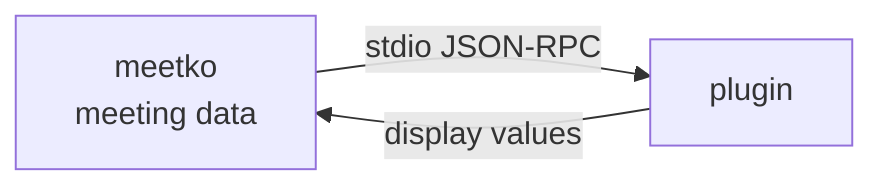

<div align="center">

# meetko-plugins

**Plugins for [meetko](https://github.com/Eastsidegunn/meetko): the catalog and the official examples.**

[](LICENSE)
[](#available-plugins)
[](https://github.com/Eastsidegunn/meetko)

**English** · [한국어](README.ko.md)

</div>

---

This repository is the plugin catalog for meetko, a local-first app for Korean–English meeting transcripts. The app's
**Browse** screen reads this repository's [`index.json`](index.json), and the official example plugins live here as
folders.

## What is a meetko plugin?

A plugin is a separate program that works like a function: meetko hands it the meeting data (a transcript whose words
have ids, times and speakers) over stdio JSON-RPC, and it returns values for the app to display, such as a summary
card, action items or a table. Each plugin has a `meetko.toml` manifest that declares what it reads and which
permissions it needs (network, API keys, settings); you see and approve those before it is installed.



Manifest format: meetko's [docs/manifest-draft.md](https://github.com/Eastsidegunn/meetko/blob/main/docs/manifest-draft.md)
(Korean). Plugins in meetko: [docs/plugins.md](https://github.com/Eastsidegunn/meetko/blob/main/docs/plugins.md).

## Available plugins

| Folder | id | What it does | Permissions | Install |
|---|---|---|---|---|
| [`action-items-py`](action-items-py/) | `eastsidegunn/action-items-py` | Marks action items and decisions with rules (regular expressions). Python standard library only. | No network, no API keys | `github:Eastsidegunn/meetko-plugins/action-items-py@main` |
| [`summary-py`](summary-py/) | `eastsidegunn/summary-py` | Summarizes the meeting with AI and pulls out to-dos and decisions. Drops any item whose cited word range is not in the actual transcript. | **Uses the network.** The conversation text is sent to the AI service you choose. API keys: `ANTHROPIC_API_KEY` or `OPENAI_API_KEY` (+ `OPENAI_BASE_URL` for an OpenAI-compatible server). Settings: `ANTHROPIC_MODEL`, `ANTHROPIC_BASE_URL`, `OPENAI_MODEL` | `github:Eastsidegunn/meetko-plugins/summary-py@main` |
| [`talk-time-rs`](talk-time-rs/) | `eastsidegunn/talk-time-rs` | Shows talk time per speaker as a table. A Rust executable. **Not in the Browse list** because it needs a build; an example you build from source. | No network, no API keys | Build it yourself (below) |

## Install

**In the app:** plugin screen → **Browse** (둘러보기) → **Load list** (목록 불러오기) → **Install** (설치).

**From the command line:**

```sh
meetko plugin install github:Eastsidegunn/meetko-plugins/action-items-py@main
meetko plugin install github:Eastsidegunn/meetko-plugins/summary-py@main
pbpaste | meetko plugin secret set eastsidegunn/summary-py ANTHROPIC_API_KEY   # the key value comes from stdin
```

Use a tag or commit sha instead of `@main` to pin that version. Either way, the install is pinned to the commit at
that moment.

**talk-time-rs**, built from source and added as a local folder:

```sh
git clone https://github.com/Eastsidegunn/meetko-plugins
(cd meetko-plugins/talk-time-rs && cargo build --release --locked)
meetko plugin add ./meetko-plugins/talk-time-rs
```

## Get your plugin listed

Plugins by anyone can be listed here. Your plugin stays in **your own repository**; this repository only lists it.

1. **Make the plugin in your own public GitHub repository.** Put `meetko.toml` at the repository root or in one folder.
   The `package.id` must start with your GitHub owner name in lowercase. Example: `github.com/alice/meetko-summary` →
   `id = "alice/summary"`.
2. **Commit what runs.** Nothing is built during install. Interpreted plugins (Python and the like) run from source;
   compiled plugins must commit the built executable, and the manifest's command must point to a committed file.
3. **Tag a release** when you publish a version.
4. **Open a pull request** that adds one row to `plugins` in [`sources.json`](sources.json):

   ```json
   {"repo": "alice/meetko-summary", "ref": "v1.0.0"}
   {"repo": "alice/my-plugins", "path": "summary", "ref": "v1.0.0"}
   ```

   `path` is the folder in your repository (the root if omitted). **A `ref` (a release tag or a full 40-character
   commit sha) is required**, so the listing stays on the version reviewed in the PR. Rows that follow the default
   branch are not accepted (only this repository's own example rows do). A new version is a PR that changes `ref`.

What the check (`tools/make-index`) enforces:

- every `sources.json` row is well formed, and third-party rows have a `ref`;
- **size caps apply to the whole repository archive**, not just your folder: 25 MB download, 100 MB unpacked, 5000
  entries. A folder inside a very large repository cannot be installed;
- for this repository's folders, the app's install rules too: **no symbolic links or submodules**, **portable file
  names** (no Windows device names, trailing dot or space, `\ : * ? " < > |` or control characters), **at most 32
  levels deep**, a manifest that passes the checks with the id's publisher equal to the repository owner, and a
  command that is a committed file;
- every plugin folder here is either listed or named in `unlisted`.

You can run the same check locally: `python3.12 -I tools/make-index` (no network). After a merge, the index is
rebuilt by reading each manifest from GitHub at that exact commit and pinning it to the commit sha (see
[For maintainers](#regenerating-indexjson)).

Full publishing and install rules: meetko's
[docs/plugin-publishing.md](https://github.com/Eastsidegunn/meetko/blob/main/docs/plugin-publishing.md) (Korean, with
an English summary). Please report a problematic plugin as an issue on this repository.

## Security notes

> [!IMPORTANT]
> **Being listed means the format is right, not that the code was reviewed.** Install only plugins you trust.

- **macOS:** meetko runs plugins inside an OS sandbox. No network unless the plugin declares it and you agreed at
  install time; no home folder, meetko data folder, other processes or external drives; writes only to a temporary
  HOME made fresh for each run.
- **A plugin with network permission can send out what it reads** (the transcript it was given), to any host. Audio is
  never passed to plugins.
- **Windows and Linux:** no isolation yet. Plugins run with your account's permissions, and the declared permissions
  are not enforced.

Details and known gaps: meetko's
[docs/plugin-security.md](https://github.com/Eastsidegunn/meetko/blob/main/docs/plugin-security.md).

## For maintainers

### Tests

```sh
python3.12 -I tools/make-index                       # sources.json and plugin folders (no network)
python3 -I summary-py/test_summary.py                # no network (a fake server on 127.0.0.1)
(cd talk-time-rs && cargo test --locked && cargo build --release --locked)
```

`testdata/` is a copy of the meeting example and output schema (contract 0.1) from meetko's `contract/`.
`tools/build_index.py` and `index.schema.json` are copies from meetko's `tools/plugin-index/` (update them together).

### Regenerating `index.json`

> [!NOTE]
> GitHub Actions in this repository are currently turned off, so index updates are manual for now.

The workflows are in place for when Actions are turned on: [`check.yml`](.github/workflows/check.yml) runs
`tools/make-index` and the summary-py tests on pull requests and pushes to `main`, and
[`index.yml`](.github/workflows/index.yml) (`plugin index`) rebuilds `index.json` from `sources.json` when it changes on
`main`, once a day, or when run by hand from the Actions tab, and commits it when it changed. Its `commit` job must be
able to push to `main`.

Manually, without network:

```sh
python3.12 -I tools/make-index --sha <commit on main>
```

Then commit and push the result.

- The sha must be a commit that is already on GitHub `main`, or the app refuses the install.
- Rows for other people's repositories can only be made by the workflow; this command keeps those rows from the
  current `index.json` as they are.
- To check: `curl -s https://raw.githubusercontent.com/Eastsidegunn/meetko-plugins/main/index.json` should show the
  two entries (`action-items-py`, `summary-py`) with their `path` and a 40-character `sha`, and they should install
  from the app's Browse screen.

The index is a convenience filter, not a review. Remove a plugin by deleting its `sources.json` row, or with a
`blocklist.txt` (one entry per line: `OWNER/REPO`, `OWNER/REPO/FOLDER`, `OWNER/*` for every repository of an owner, or
a 40-character commit sha; `#` starts a comment).

## License

[AGPL-3.0-or-later](LICENSE). Copyright (C) 2026 Eastsidegunn.
